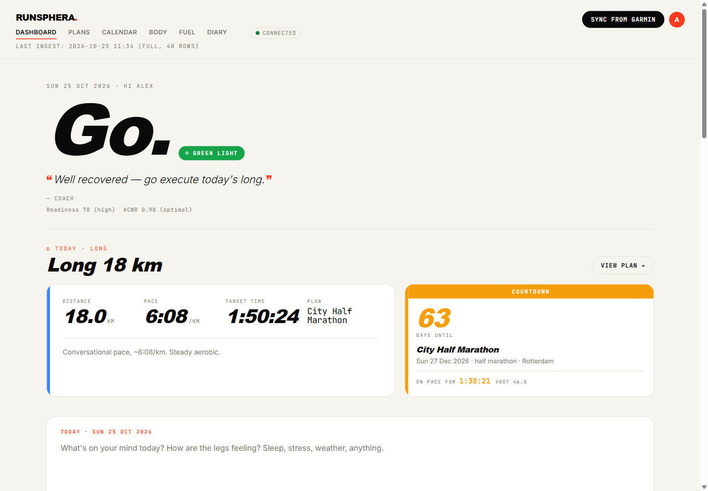
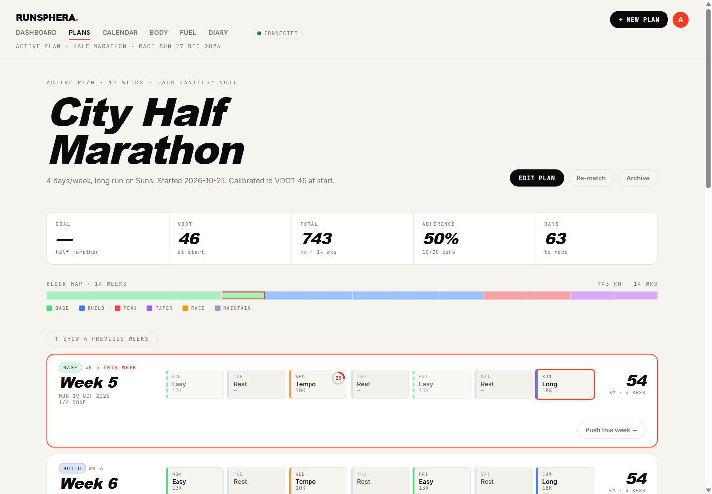
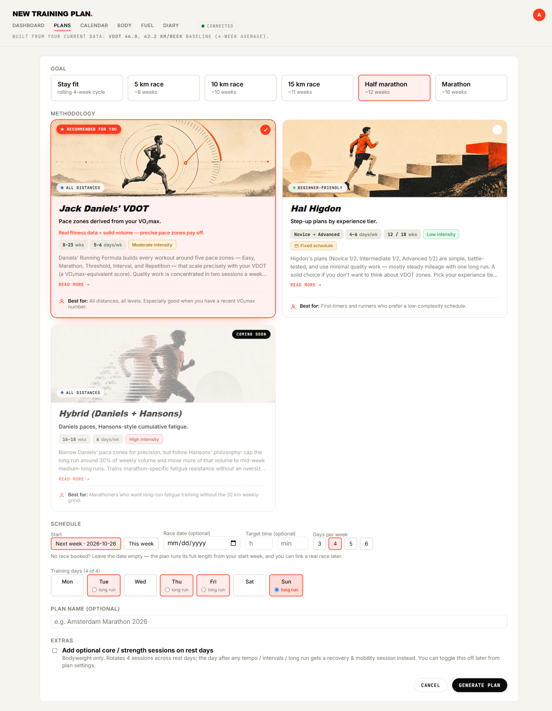

# RunSphera

> **Run Better. Go Further.**

A local-first running coach. It pulls your data from Garmin Connect, analyzes it,
builds a training plan around a race goal, pushes the planned sessions back to your
watch, and talks you through each day.

Everything runs on your own machine. Your Garmin credentials never leave it.

---

## What it does

- **Sync from Garmin** — activities, daily metrics, training readiness and training status, into a local SQLite file.
- **Dashboard** — your fitness state at a glance: VO₂max, training status, readiness, acute/chronic load, weekly mileage, time in HR zones, and the run you just finished.
- **Training plans** — pick a goal and a methodology; get a week-by-week plan calibrated to *your* VO₂max and *your* recent volume, on the days you actually train. Six methodologies: Daniels' VDOT, Pfitzinger 18/55, Hal Higdon (six tiers), Couch to 5K, Mike Foppen's 7 Heuvelen, and a stay-fit cycle.
- **Push to watch** — send a planned session to Garmin Connect; it syncs to the watch and guides you through it with real pace targets on every segment.
- **Daily coach voice** — a banner that speaks to today's data: readiness, recent runs, diary notes, what's coming up. The rules engine decides; an LLM voices it. Optional — works fine without.
- **Body check-in** — tap a body map to log how something actually feels. Active issues, history, heatmap, and the coach reads it as ground truth.
- **Fuel** — daily energy and carb targets, hydration, long-run fuelling, and concrete Dutch meals scaled to the target.
- **Race calendar** — a curated Dutch race calendar plus your own events; swap one into your plan and the week reshapes around it.
- **Runner's diary** — free-text notes and mood per day or per run.
- **English or Dutch**, light or dark, on a single visual language.

Garmin is optional. Onboarding has a skip path, and the plan engine, fuel engine
and diary all work without it — you just enter your own baseline.

---

## What it looks like

**Dashboard** — today's call in a coach's voice, the session itself, and the
countdown to your A-race with a projected finish time.



**Plans** — the whole block at a glance: phase map, adherence, and every week
laid out day by day. The ring on a completed session is its execution score.



**Creating a plan** — pick a goal and a methodology. Six are implemented, each
with its own rules about distances, days per week, and whether it uses pace
zones at all.



> These are from a seeded demo database, not a real runner —
> `python -m scripts.seed_demo` builds it. Regenerate it and retake the shots
> rather than letting them drift.

---

## Quick start

Pre-requisites: Python 3.12+, and (optionally) a Garmin Connect account with a paired watch.

**Install (once):** double-click **`install.cmd`** in the repo root. It creates the
virtual environment, installs dependencies (progress shown in a console window),
and adds **RunSphera** shortcuts to your Desktop and Start Menu. Re-run it any time
to repair a broken install.

**Launch:** open **RunSphera** from the Desktop or Start-Menu shortcut — or
right-click it and choose *Pin to taskbar* to keep it one click away. It opens the
dashboard in its own native window (a branded splash shows during the few seconds
it takes to start); no terminal, no browser tab. Close the window to quit. See
[docs/desktop-launcher.md](docs/desktop-launcher.md).

> **Pin the shortcut, not the running window.** The shortcut carries the RunSphera
> icon and taskbar identity; pinning the live window instead falls back to the
> generic Python icon.

**Prefer a terminal?** Once the venv exists — via `install.cmd`, or set it up
manually with `python -m venv .venv` then
`.venv\Scripts\python.exe -m pip install -r requirements.txt`:

```powershell
# The native app window — same as the RunSphera shortcut
.venv\Scripts\python.exe -m runsphera.desktop

# …or the plain web app, in your browser at http://localhost:8000
.venv\Scripts\python.exe -m runsphera.web
```

First launch walks you through a short setup: connect Garmin (or skip it), sync,
build a first plan, and optionally add a coach voice and your location.

**Credential handling:** your Garmin password is sent to Garmin Connect once during
the first sign-in, then dropped. It's never written to disk or the database. The
session token Garmin returns is cached in `.garmin_tokens/` (gitignored) and
re-used — typically valid for months. Your email is remembered so the form
pre-fills on re-auth. Settings has a Disconnect button that clears the session.

**Coach voice (optional):** Settings → the provider tab for Anthropic, OpenAI or
Gemini. Paste a key and the daily banner is written by that model. The key is
stored in the local SQLite. Without one, the rules-based headline shows instead —
nothing breaks.

**Optional env vars** (skip unless you need them):

- `GARMIN_EMAIL` + `GARMIN_PASSWORD` — bypass the web sign-in, for a scheduled
  headless ingest. Consulted only when the token cache is empty.
- `GARMIN_TOKEN_DIR` — where the session token is cached. Defaults to `./.garmin_tokens`.
- `ANTHROPIC_API_KEY` — alternative to the Settings page. A key saved in Settings wins.
- `RUNNING_COACH_DB` — point the app at a different database file.
- `RUNNING_COACH_ALLOWED_HOSTS` — comma-separated extra hostnames the app may be
  served on. Loopback (`localhost`, `127.0.0.1`, `::1`) is always allowed; set this
  only if you serve RunSphera to another device on your network. See
  [docs/same-origin-protection.md](docs/same-origin-protection.md).

Set these in a `.env` file in the project root. The web flow needs none of them.

---

## Daily workflow

1. **Open RunSphera.**
2. **Click "Sync from Garmin."** Idempotent — safe to click whenever. A brand-new run opens its own detail panel automatically.
3. **Read the banner** — today's call, in a coach's voice, with the reasoning behind it.
4. **Check today's session** on the hero card; after you've run it, the same card flips to what you actually did.
5. **Go to Plans** for the week-by-week view, and **Send to watch** on the sessions you want guided.
6. **Log anything that hurts** on the Body tab, and anything worth remembering in the Diary.

---

## Documentation

This README is the front door. Everything deeper lives in [docs/](docs/):

- **[docs/README.md](docs/README.md)** — index of every feature page.
- **[docs/architecture.md](docs/architecture.md)** — the load-bearing decisions and why each was made. Start here before changing anything structural.
- **[docs/roadmap.md](docs/roadmap.md)** — what's done, what's next, what's parked.
- **[docs/design-system.md](docs/design-system.md)** — the visual language.
- **[docs/_template.md](docs/_template.md)** — copy this when documenting a new feature.

Each feature page covers purpose, user view, implementation map, configuration,
known limitations, and a manual verification routine. When a feature ships or gets
reshaped, its page is updated in the same change.

---

## Working on the code

Start with **[CONTRIBUTING.md](CONTRIBUTING.md)** — setup, the test
conventions, and how to open a pull request.

Then **[CLAUDE.md](CLAUDE.md)** for the architecture summary, the operational
gotchas, and the development workflow, and **[AGENTS.md](AGENTS.md)** for the code
review standards. All three apply to humans and coding agents alike.

```powershell
# Install dev dependencies too — pytest is not in requirements.txt
.venv\Scripts\python.exe -m pip install -r requirements.txt -r requirements-dev.txt

# Run the tests (383 tests, ~6 s, no network)
.venv\Scripts\python.exe -m pytest tests -q

# Web app with auto-reload, for development
.venv\Scripts\uvicorn.exe runsphera.web.app:app --reload --port 8000

# Pull from Garmin into SQLite from the command line
.venv\Scripts\python.exe -m runsphera.ingest
.venv\Scripts\python.exe -m runsphera.ingest --activities 60 --days 30

# Dump raw Garmin JSON to data/raw/ for schema work
.venv\Scripts\python.exe -m scripts.explore
```

---

## Troubleshooting

**"Garmin verification code" on first sign-in**
Garmin's SSO emails a 6-digit code on any new session — unrelated to account-level
MFA. The form moves to a code step automatically. Check your inbox and spam. After
this, the token is cached and you won't be prompted again for months.

**Sync fails or bounces you back to the sign-in page**
The cached token expired. Your email is pre-filled; enter the password and the new
code Garmin sends.

**Dashboard is empty, or shows "—" everywhere**
You haven't synced yet, or the last sync failed. Click "Sync from Garmin". The bar
under the title shows the last ingest timestamp and its status.

**"Push failed: …" on a session**
Either Garmin auth expired (disconnect and reconnect in Settings), or Garmin
rejected the workout shape. The error shows inline on the day card.

**No "Send to watch" button on a session that should have one**
Rest and cross days never have one. Otherwise it usually means a structured
session (tempo, intervals) is missing its structure — see
[docs/garmin-workout-push.md](docs/garmin-workout-push.md).

**The watch didn't get the pushed workout**
Check Garmin Connect first (web or phone, training calendar). If it's there, the
watch picks it up on the next sync — open the Connect app with the watch nearby.

**The native window never appears**
The launcher runs without a console, so it writes to `data/desktop.log`. That file
is the only trace of what went wrong.

**Something broke after a schema change**
Migrations in `db.py` are idempotent `ALTER TABLE` statements. Adding a column?
Append to `_MIGRATIONS` *and* add it to `SCHEMA`. Back up
`data/running_coach.db` before anything larger — the Garmin data regenerates, but
your plans, diary and body history do not.

---

## License

RunSphera is released under the [MIT License](LICENSE). Self-hostable, forkable,
run your own instance. There is no hosted version and no account to sign up for.

## Disclaimer

**Not affiliated with Garmin or Anthropic.** Garmin, Garmin Connect and Fenix are
trademarks of Garmin Ltd. Claude and Anthropic are trademarks of Anthropic PBC.
This project is an independent personal tool and is endorsed by neither.

**Garmin access is unofficial.** RunSphera talks to Garmin Connect through the
community-maintained [`garminconnect`](https://github.com/cyberjunky/python-garminconnect)
library, not a published Garmin API. Garmin can change or remove those endpoints
without notice, and using them may fall outside Garmin's Terms of Service. You are
responsible for your own account. Use at your own risk.

**Not medical advice.** Training prescriptions come from published methodologies
applied to your own data. They are not reviewed by a doctor, physiotherapist or
coach, and the app cannot see what a human would. If something hurts, stop and ask
a professional — the body-check-in feature is a log, not a diagnosis.

**No warranty.** As stated in the licence, the software is provided "as is". Back up
`data/running_coach.db` before anything structural: Garmin-sourced data regenerates
on the next sync, but your plans, diary entries and body history do not.
